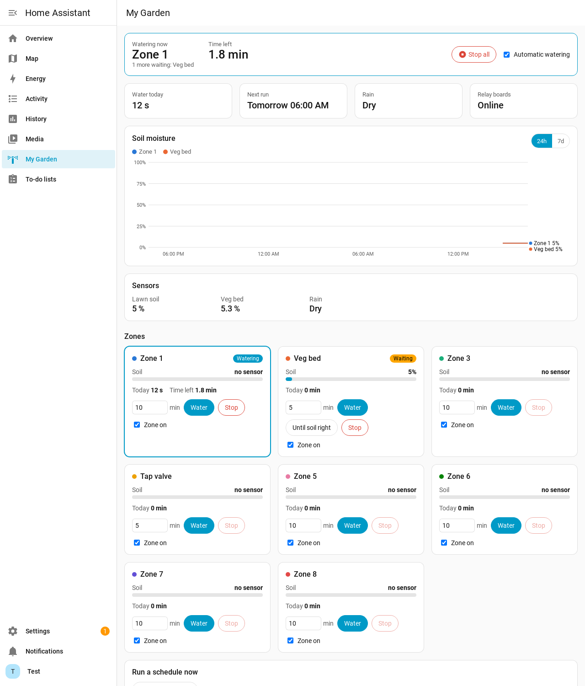

# Smart Garden for Home Assistant

Brings a **Smart Garden** irrigation controller into Home Assistant: every zone as a switch, soil
moisture, watering today, time left, next run, rain and relay-board status, plus **Stop all**,
**Run schedule** buttons and a **Water zone** action for automations. The Smart Garden app stays in
charge of safety - one zone at a time, each zone's time limit, valves checked off - so Home Assistant
can't over-water even if an automation goes wrong.

Works with any Home Assistant install (Container, Core, OS). On Home Assistant OS you can instead use
the [Smart Garden app](https://github.com/sharjeelkiyani/smart-garden-ha), which runs the controller
itself inside Home Assistant.

## Install

**Home Assistant 2026.11 or newer (Marketplace)**
1. **Marketplace → Add from a GitHub link** → `sharjeelkiyani/smart-garden-integration` → **Add**, then
   install **Smart Garden**.
2. Restart Home Assistant.

**Older versions with HACS:** HACS → ⋮ → Custom repositories → this repository, type *Integration*.

**By hand:** copy `custom_components/smart_garden` into your `config/custom_components/` and restart.

## Set up
**Found by itself (easiest).** Smart Garden announces itself on your home network, so Home Assistant
shows it under **Settings → Devices & services → Discovered**.

1. Press **Add** on *Smart Garden*, then **Submit**. Home Assistant shows a 6-digit code.
2. Open the Smart Garden website signed in as an admin. A banner says *Home Assistant wants to
   connect*. Check it shows the same code and tap **Allow**.
3. Done - no address or key to type. Home Assistant follows the garden if its IP address changes.

**Not discovered?** (Home Assistant and the garden on different networks, Home Assistant in Docker
without host networking, or the app older than this feature.) **Add integration → Smart Garden**, type
the address you open Smart Garden at (for example `http://192.168.1.50:5120`) and leave the key empty
to pair the same way - or paste a connection key made in Smart Garden under **My account → Connection
keys**.

Pairing makes a connection key for the admin who tapped Allow (you'll see it under **My account →
Connection keys**). A key acts as the account it belongs to:
- **user** account - see everything, water, stop, run schedules;
- **admin** account - also turn zones and automatic watering on or off.

Revoke the key in Smart Garden at any time; Home Assistant then asks to reconnect - leave the key empty
to pair again. Moved the garden to a new name or https address?
**Settings → Devices & services → Smart Garden → ⋮ → Reconfigure**.

## What you get

| Device | Entities |
|---|---|
| Garden | Watering now, Time left, Next run, Water today, Raining, Relay boards, garden sensors (soil, temperature, humidity, rain, alarm), Stop all, Run *schedule*, Automatic watering (admin) |
| Each zone | Water (on = water for the zone's usual minutes, off = stop), Soil moisture, Watered today, Time left, Zone on (admin) |

**Action `smart_garden.water`** - target a zone's *Water* switch:

```yaml
action: smart_garden.water
target:
  entity_id: switch.front_lawn_water
data:
  minutes: 5            # or: until_soil: true  (needs a soil sensor on the zone)
```

If another zone is watering, the new one waits its turn.

## Dashboard
The integration adds **Smart Garden** to the sidebar: a dashboard drawn by Home Assistant itself, so
it works over HTTPS or not, at home or away, in the Home Assistant app too, with no second sign-in.

- **Watering now** with time left and what's waiting, **Stop all**, automatic watering on/off (admin)
- **Water today, next run, rain, relay boards**
- **Soil moisture chart** for the last 24 hours or 7 days (from Home Assistant's history)
- **Sensors** - soil, temperature, humidity, rain, alarm
- **Zones** - soil level, watered today, time left; *Water* for some minutes, *Until soil right*, *Stop*,
  zone on/off (admin)
- **Run a schedule now**

It follows your Home Assistant theme, light or dark. Turn it off in the integration's **Configure**
options.

**The full app in the sidebar too (optional).** In **Configure**, set *Also show the full app at this
address*. Browsers only keep you signed in to it inside Home Assistant when it's on the *same site*:
over HTTPS that means a path on Home Assistant's own address through your reverse proxy, e.g.
`https://your-ha-address/garden/` (Smart Garden setting `URL_PREFIX=/garden`).



## Privacy
Everything stays on your network: Home Assistant talks only to your Smart Garden, every 10 seconds,
with the key you gave it. Nothing is sent anywhere else.

## Problems
Open an issue: https://github.com/sharjeelkiyani/smart-garden-integration/issues
